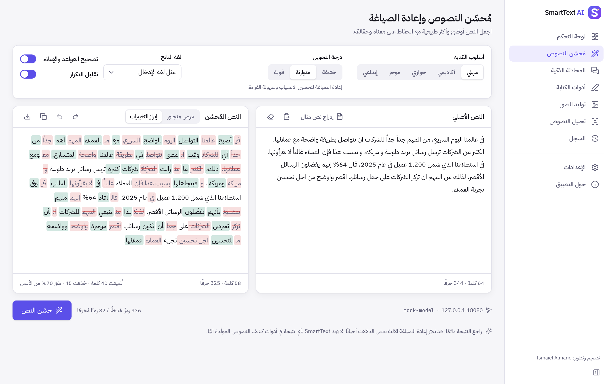
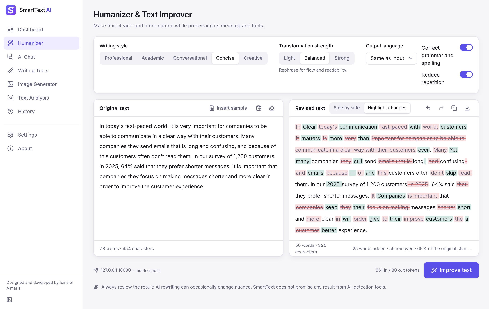

<p align="center"></p>

# SmartText AI

AI writing, chat and image assistant for **macOS** and **Windows 10/11**, with a full **Arabic (RTL) and English** interface.
Built with **Tauri 2 + Rust + React + TypeScript + Tailwind CSS + SQLite**.

**Designed and developed by Ismaiel Almarie.**

| Arabic (RTL) | English |
|---|---|
|  |  |

> The screenshots come from the real app UI running in browser development mode. The AI responses in them are fixed text returned by the bundled **mock** server (`scripts/mock/mock-provider.mjs`), not by a real model.

---

## Features and status

Legend: ✅ implemented and covered by automated tests · 🔑 needs your API key to produce real output · 🖥️ needs a macOS or Windows machine (or the CI workflow) to build and verify · ❌ not implemented

| Feature | Status | Notes |
|---|---|---|
| Humanizer and text improver (5 styles, 3 strengths, output language, side-by-side and highlighted changes, undo/redo, copy, download, word and character counts) | ✅ 🔑 | Prompts focus on keeping the meaning. The app makes no promises about AI-detector results. |
| AI chat (history, new, rename, delete, copy, regenerate, Markdown, code blocks, RTL/LTR) | ✅ 🔑 | Conversations are stored locally; storage can be turned off. Replies arrive in one piece (no streaming). |
| 12 writing tools (paraphrase, summarize, grammar, spelling, translate, tone, email, expand, shorten, headlines, ideas, bullet points) | ✅ 🔑 | |
| Image generation (prompt, aspect ratio, quality, style presets, progress, preview, save, local history) | ✅ 🔑 | OpenAI Images API (`gpt-image-1`, `dall-e-3`). Without a key, a setup screen is shown instead of fake images. Live image generation has not been tested (no key). Negative prompts are disabled because OpenAI does not support them. |
| Text similarity (local comparison of two documents, shared passages, Arabic normalization) | ✅ | Runs on your device only. It is **not** an internet-wide plagiarism search. |
| AI-text detection | ❌ (integration point only) | No detection provider is bundled, and the app never shows invented scores. See `src/lib/ai/detection.ts`. |
| Providers: OpenAI, Anthropic (Claude), any OpenAI-compatible server (Ollama, LM Studio, OpenRouter, vLLM…) | ✅ 🔑 | Requests and responses are tested with mocks. Live calls have **not** been tested because no API keys were available during development. |
| API keys in the OS keychain (macOS Keychain, Windows Credential Manager) | ✅ 🖥️ | Implemented with the Rust `keyring` crate. Keychain saving was not tested here, because the Linux build container has no keychain service. |
| SQLite local storage (settings, history, conversations, images) | ✅ | Checked in the Linux desktop build: the database is created on first launch. |
| Arabic/English UI with full RTL, light/dark/system theme, keyboard navigation (Ctrl/⌘+1…9) | ✅ | |
| macOS `.app` + `.dmg` (Apple Silicon and Intel) | 🖥️ | Build configuration and CI workflow included, but not built yet: that needs a Mac or the GitHub Actions workflow. |
| Windows `.msi` + NSIS `-setup.exe` (x64) | 🖥️ | Same as macOS: configuration and CI workflow included, not built yet. |
| Linux `.deb` / `.rpm` / AppImage | ✅ | Built and launched in this repository's development environment (not an official target). In that build, a Humanizer request went end to end through the Rust layer to a local mock server (screenshot `docs/screenshots/desktop-humanizer.png`). |
| Response streaming, cost estimates | ❌ | Token counts are shown when the provider reports them. No prices are estimated. |

## Prerequisites

- **Node.js 22** (20.19+ works) and npm
- **Rust** stable (1.77+) via [rustup](https://rustup.rs)
- Platform tools: see [INSTALL_MACOS.md](INSTALL_MACOS.md) or [INSTALL_WINDOWS.md](INSTALL_WINDOWS.md)

## Setup

```bash
npm ci
```

## Run

**Desktop app (development mode, hot reload):**

```bash
npm run tauri dev
```

Enter API keys in **Settings → AI providers**. They are saved to the OS keychain.

**Browser development mode** (no Rust needed; keys come from `.env`):

```bash
cp .env.example .env      # add your keys
npm run dev:web           # starts the local proxy (port 8787) and Vite (http://localhost:1420)
```

## Test

```bash
npm test                              # 104 Vitest unit, integration and UI tests (mocked providers)
npm run typecheck
(cd src-tauri && cargo test)          # Rust: URL allow-list, key validation, redaction
node scripts/manual/capture-screenshots.mjs   # end-to-end UI run against the MOCK server (+ screenshots)
```

The end-to-end script needs Playwright with Chromium. If it is not installed globally, run `npm i -D playwright && npx playwright install chromium`.

## Build installers

```bash
npm run tauri build                                         # installers for the OS you are on
npm run tauri build -- --target aarch64-apple-darwin        # macOS Apple Silicon
npm run tauri build -- --target x86_64-apple-darwin         # macOS Intel
npm run tauri build -- --target universal-apple-darwin      # macOS universal
```

Output goes to `src-tauri/target/[<target>/]release/bundle/` (`dmg/`, `macos/`, `msi/`, `nsis/`, `deb/`, `appimage/`).
Building on one OS does **not** produce installers for the others. Use the GitHub Actions workflow
[`.github/workflows/release.yml`](.github/workflows/release.yml) (run it manually or push a `v*` tag). It builds macOS arm64, macOS x64 and Windows x64 on native runners.

## Documentation

- [USER_MANUAL_AR.pdf](USER_MANUAL_AR.pdf): Arabic user manual (دليل استخدام SmartText AI)
- [TECHNICAL_GUIDE.md](TECHNICAL_GUIDE.md): architecture, adding providers, troubleshooting
- [INSTALL_MACOS.md](INSTALL_MACOS.md), [INSTALL_WINDOWS.md](INSTALL_WINDOWS.md)
- [SECURITY_AND_PRIVACY.md](SECURITY_AND_PRIVACY.md)
- [.env.example](.env.example): placeholders only

## Project structure

```
src/                React UI
  app/              shell: sidebar, navigation items
  pages/            Dashboard, Humanizer, Chat, WritingTools, ImageGenerator, TextAnalysis, History, Settings, About
  components/       reusable UI (ui/ primitives, DiffView, Markdown, ErrorAlert, ProviderBadge, settings/ProviderCard…)
  state/            zustand stores (settings, chat, nav, toasts, AI client)
  i18n/             en.ts, ar.ts (identical key sets, enforced by tests)
  lib/ai/           provider-independent client, adapters (openai, anthropic), errors, retry, prompts, tools catalogue
  lib/db/           Store interface, SQLite store (desktop), memory store (browser/tests)
  lib/text/         validation, counts, direction detection, diff, local similarity
src-tauri/          Rust: keychain secrets, provider request proxy (allow-list, timeout, redaction), file saving
server/             browser dev-mode proxy (Node/TypeScript), mirrors the Rust rules
tests/              Vitest suites
scripts/            mock provider, screenshot/E2E runner, PDF manual builder
docs/               screenshots and manual sources
```

## License

MIT © 2026 Ismaiel Almarie. See [LICENSE](LICENSE).
SmartText AI is an independent product. It is not affiliated with Humbot AI, OpenAI or Anthropic.
